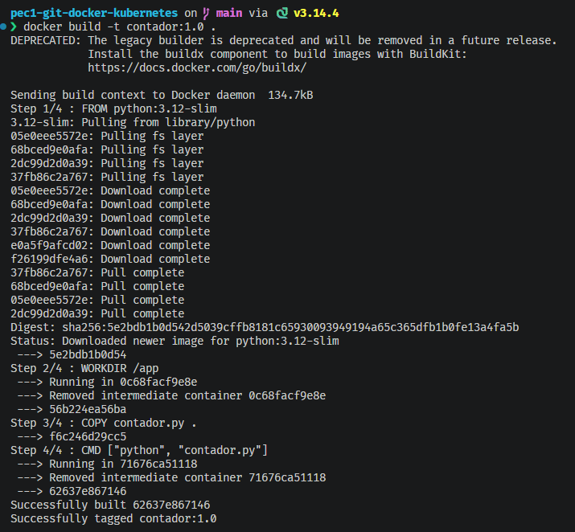
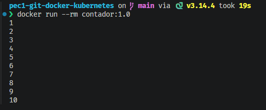
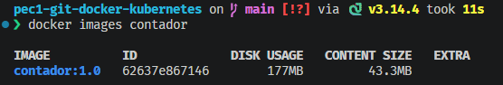
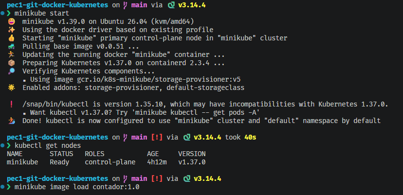
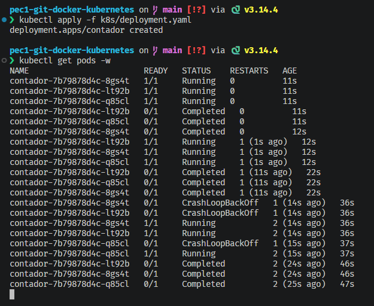
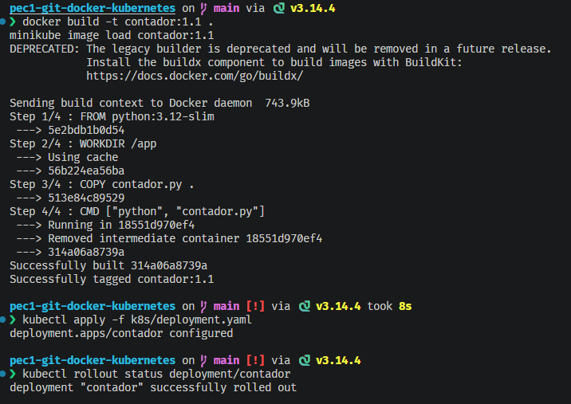
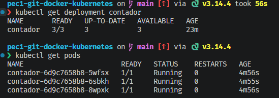
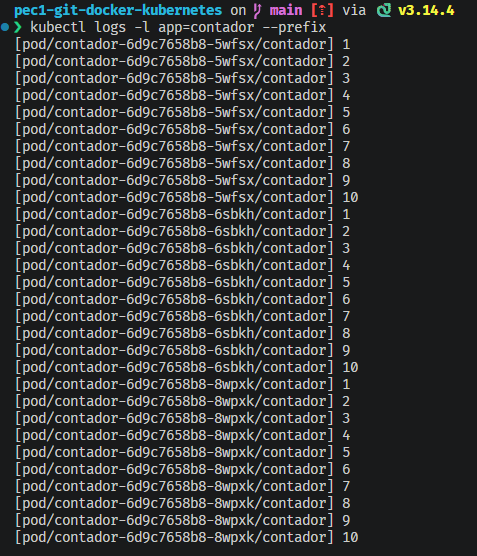

# PEC1: Git, Docker y Kubernetes

Autor: Carlos Álvaro Arroyo Parejo

Repositorio: https://github.com/CAArroyoUAH/pec1-git-docker-kubernetes 

1. Script Python
2. Imagen Docker
3. Despliegue en Kubernetes

> Nota sobre los _commits_: los mensajes seguirán la convención de prefijos de algunas de las librerías más conocidas como NumPy, SciPy o pandas (aunque se trate de una práctica sencilla). Ejemplos:
>
> - `ENH`: funcionalidad nueva
> - `BUG`: corrección de errores
> - `BLD`: build e imágenes Docker
> - `MAINT`: mantenimiento y ficheros de configuración
> - `DOC`: documentación e informe

## 1. Script Python

Se ha creado el script `contador.py`, un bucle, que imprime los números del 1 al 10 con una pausa de un segundo entre ellos. Nótese que se ha añadido `flush=True` para que la salida aparezca inmediatamente en los logs de Docker y Kubernetes.

```python
import time

for i in range(1, 11):
print(i, flush=True)
time.sleep(1)
```


## 2. Docker

Se crea el Dockerfile que contiene la siguiente información:
* `FROM`: es la imagen de la versión de Python usada, en mi caso 3.12 en versión reducida.
* `WORKDIR`: directorio de trabajo dentro del contenedor. 
* `COPY`: copia nuestro script `contador.py`dentro de la imagen de Docker.
* `CMD`: comando que se ejecuta al iniciar el contenedor.

```docker
FROM python:3.12-slim
WORKDIR /app
COPY contador.py .
CMD ["python", "contador.py"]
```

Lo siguiente es construir la imagen. Docker lee la información anterior y crea la imagen que no es más que un "paquete" de lo anterior.



Después, docker toma la imagen construida y crea un contenedor que es un proceso aislado que arranca partiendo de la imagen. Aquí si se ejecuta el `CDM` de nuestro Dockerfile y, por eso, aparecen los números de `contador.py`.



Por último, podemos comprobar que la imagen existe y su tamaño.



## 3. Kubernetes

Con Kubernetes podemos gestionar los contenedores de forma automática, ya que podemos decidir dónde se ejecuta, cuándo se reinician y mentener las copias o réplicas que indiquemos. En otras palabras, Kubernetes nos permite administrar los contenedores de forma conjunta.

Lo primero es crear un clúster de Kubernetes de un solo nodo utilizando un contenedor de Docker con `minikube`, para posteriormente usar `kubectl` para enviar las intrucciones y controlar el clúster. Usamos de nuevo `minikube` para cargar la imagen nuevamente ya que utiliza su propio entorno de Docker.



Lo siguiente es el despliegue o _Deployment_ que es la forma de adminitrar varios _pods_ iguales (o la unidad más pequeña que se ejecuta con Kubernetes). En nuestro caso, tenemos un único contenedor con la imagen `contador`, indicamos tres réplicas pues es lo que nos pide el enunciado de la práctica. Por último, el `selector` y las `labels` sirven para que el Deployment pueda reconocer y gestionar los _pods_ que le pertenecen. El Deployment se hace mediante un fichero YAML que se aplica con nuestro comando `kubectl`.

```yaml
apiVersion: apps/v1
kind: Deployment
metadata:
  name: contador
spec:
  replicas: 3
  selector:
    matchLabels:
      app: contador
  template:
    metadata:
      labels:
        app: contador
    spec:
      containers:
        - name: contador
          image: contador:1.0
```



Con el comando `-w` veo cómo va cambiando el estado de los pods en tiempo real. Después de esperar unos segundos, se observa que los pods primero aparecen como `Running`, después pasan a `Completed` y finalmente terminan en estado `CrashLoopBackOff`. También se puede ver cómo aumenta el número de reinicios (RESTARTS).

Para solucionar este problema, se modifica el script añadiendo un bucle `while` para esperar al terminar de contar. Así, evitamos que el contenedor se cierre, evitando que Kubernetes tenga que reiniciarlo constantemente. Como hemos añadido una nueva «versión» pues construimos una nueva imagen como buenas prácticas. 



Con `rollout status` esperamos hasta los _pods_ nuevos sustituyan a los viejos.

Comprobamos de nuevo el Deployment con la solución propuesta, vemos `READY 3/3`, lo que significa que los tres _pods_ están funcionando correctamente y no presentan ningún reinicio. Al revisar los _logs_, podemos ver que cada uno de los _pods_ ha ejecutado el script de contador, contando 1 al 10 por separado.



